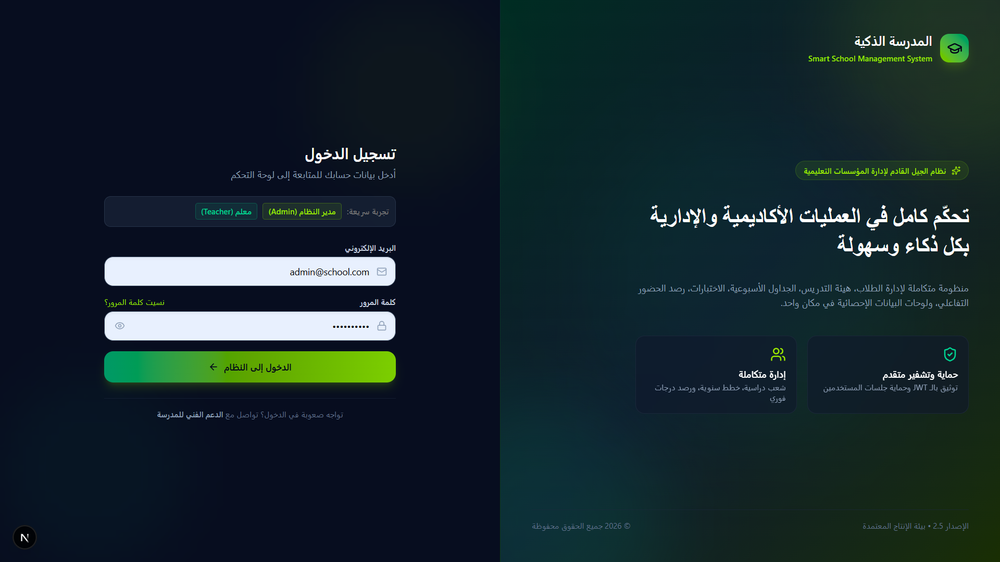
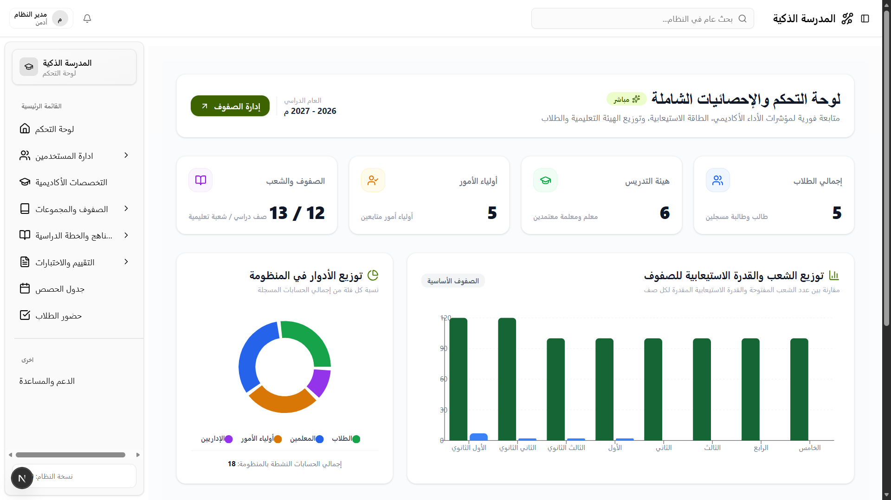
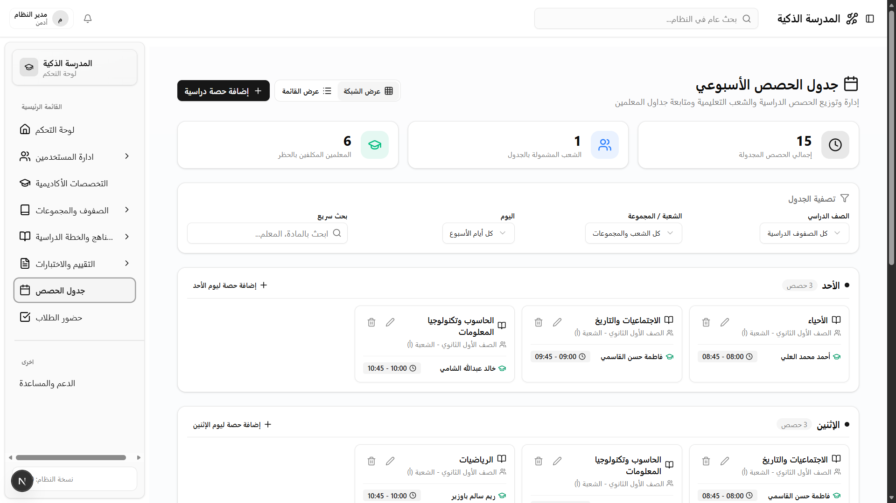
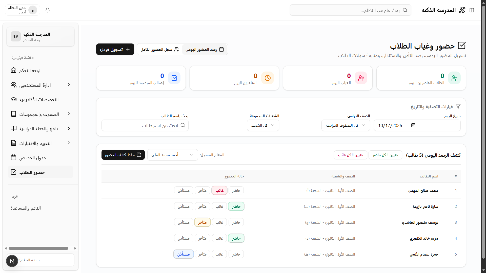
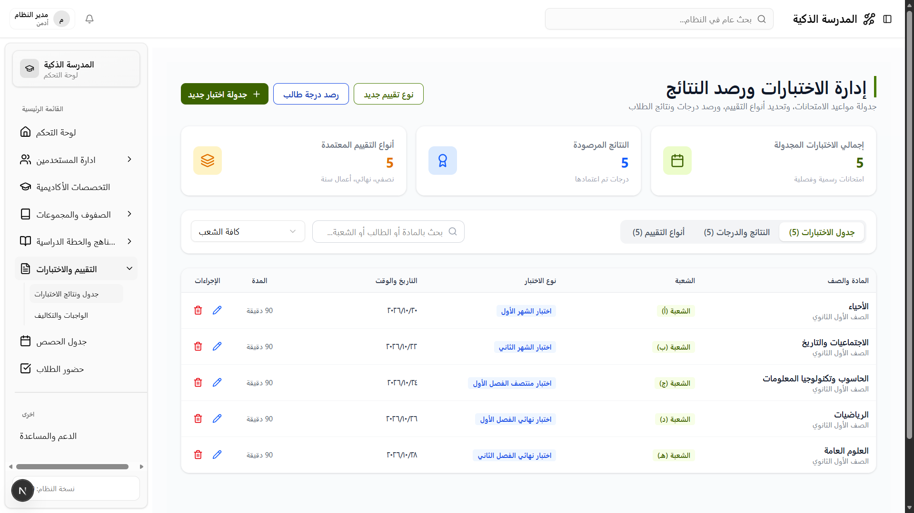
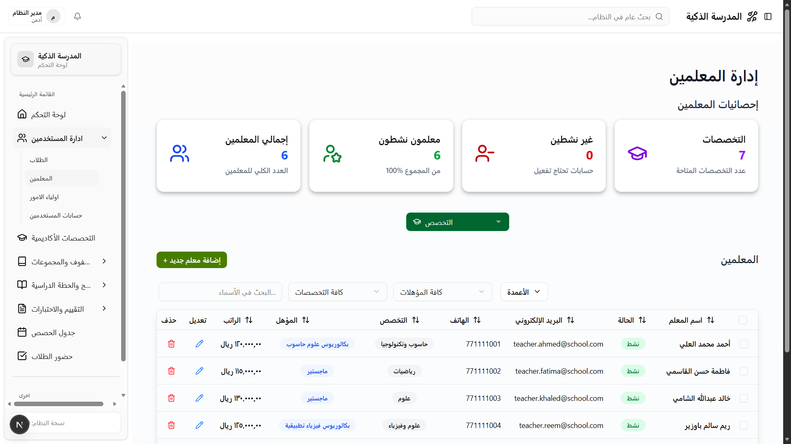

<div align="center">

# 🏫 منصة المدرسة الذكية (Smart School) - البوابة التفاعلية للويب
### نظام إدارة المؤسسات التعليمية والأكاديمية المتقدم

[](https://nextjs.org/)
[](https://react.dev/)
[](https://www.typescriptlang.org/)
[](https://tailwindcss.com/)
[](#)

<p align="center">
  منظومة برمجية متكاملة مصممة لإدارة المدارس العصرية والعمليات التعليمية بكفاءة عالية، مع توفير تجربة مستخدم سلسة ودعم كامل للغة العربية (RTL) وتصميم حديث (Modern UI/UX).
</p>

[استعراض الخصائص](#-المميزات-الرئيسية) • [هيكلية المشروع](#-هيكلية-المشروع) • [التثبيت والتشغيل](#-التثبيت-والتشغيل) • [الاتصال بالخادم](#-الاتصال-بالخادم-backend-api)

---

</div>

## 📑 فهرس المحتويات
1. [نظرة عامة](#-نظرة-عامة)
2. [المميزات الرئيسية](#-المميزات-الرئيسية)
3. [معرض الشاشات والواجهات](#-معرض-الشاشات-والواجهات)
4. [التقنيات المستخدمة](#-التقنيات-المستخدمة)
5. [هيكلية المشروع](#-هيكلية-المشروع)
6. [التثبيت والتشغيل](#-التثبيت-والتشغيل)
7. [التكامل الأمني والتوثيق](#-التكامل-الأمني-والتوثيق)

---

## 🌟 نظرة عامة
تعد بوابة الويب الخاصة بنظام **المدرسة الذكية (`Smart School Web`)** الواجهة الأمامية الرئيسية لإدارة كافة المهام الإدارية والأكاديمية، بدءاً من تسجيل الطلاب والمعلمين وتوزيع الشعب الدراسية، وصولاً إلى بناء الخطط الأسبوعية ورصد الحضور والغياب والاختبارات وتحليل البيانات عبر رسوم بيانية تفاعلية متقدمة.

---

## 🚀 المميزات الرئيسية

### 1. 🔐 تسجيل الدخول والتوثيق المتقدم (`Authentication`)
* تصميم شاشة دخول منقسم وعصري (`Split Modern Dark/Emerald Theme`).
* توثيق آمن بالـ `JWT Tokens` مع `Refresh Tokens` مخزنة في `HTTP Cookies`.
* حماية المسارات تلقائياً بواسطة `Next.js Middleware`.
* أزرار تجربة سريعة للدخول بحساب `مدير النظام (Admin)` أو `معلم (Teacher)`.

### 2. 👥 إدارة شؤون المستخدمين (`User Management`)
* **الطلاب**: تسجيل وتعديل بيانات الطلاب، مع كروت إحصائية وفلاتر حسب الصف والشعبة.
* **المعلمون**: إدارة ملفات المعلمين وتخصصاتهم ومرتباتهم مع فلترة تلقائية متطابقة بين التخصص والمؤهل.
* **أولياء الأمور**: ربط أولياء الأمور بأبنائهم مع تحديد صلة القرابة وأرقام الطوارئ.
* **حسابات النظام**: إدارة مستخدمي النظام والصلاحيات وأدوار الدخول.

### 3. 📚 إدارة المراحل والصفوف والشعب (`Academic Structure`)
* إدارة الصفوف الـ 12 من الصف الأول الابتدائي حتى الثالث الثانوي.
* توزيع الشعب والمجموعات لكل صف مع حساب الطاقة الاستيعابية.
* واجهات منظمة بأيقونات مدمجة بدون تمرير أفقي غير مريح (`No Horizontal Scroll`).

### 4. 📖 المناهج وتوزيع الحصص (`Curriculum & Subjects`)
* دليل المواد الدراسية وربطها بالصفوف وساعات الحصص ودرجات النجاح.
* توزيع الحصص والتكليفات الأكاديمية وربط المعلمين بالمواد المعتمدة.

### 5. 📝 الاختبارات والواجبات المدرسية (`Exams & Assignments`)
* **جدول الاختبارات**: جدولة الاختبارات الفصلية والشهرية مع تحديد القاعات والمدد.
* **رصد النتائج**: تسجيل درجات الطلاب الفورية مع احتساب التقديرات التلقائية (`ممتاز`, `جيد جداً`).
* **الواجبات والتسليمات**: رفع التكاليف الدراسية بمواعيد تسليم، ومتابعة تسليمات الطلاب ورصد تقييمها.

### 6. 🗓️ جدول الحصص الأسبوعي (`Weekly Timetable`)
* إمكانية العرض بنمطين: **عرض الشبكة الأسبوعية (`Weekly Grid`)** أو **عرض القائمة المدمجة (`Table View`)**.
* منع تعارض الحصص لنفس الشعبة أو المعلم في نفس التوقيت.
* اختيار سريع للحصص المعتادة بتوقيتاتها القياسية.

### 7. ⏱️ رصد الحضور والغياب اليومي (`Student Attendance`)
* نمط الرصد السريع الجماعي للشعبة مع أزرار تعيين جماعي (`الكل حاضر`, `الكل غائب`).
* سجل تاريخي متكامل مع فلترة حسب التاريخ وحالة الحضور (`حاضر`, `غائب`, `متأخر`, `مستأذن`).

### 8. 📊 لوحة التحكم والإحصائيات (`Dashboard`)
* كروت مؤشرات أداء رئيسية (`KPIs`) متصلة مباشرة بقاعدة البيانات.
* مخططات بيانية تفاعلية بواسطة `Recharts` لتوزيع الطلاب والمعلمين والطاقات الاستيعابية.
* شريط تنقل علوي ذكي (`SiteHeader`) وقائمة جانبية تفاعلية (`AppSidebar`).
* تأثير النقر التفاعلي الجمالي الشامل (`Global ClickSpark`).

---

## 🖼️ معرض الشاشات والواجهات

| شاشة تسجيل الدخول العصرية | لوحة التحكم والإحصائيات |
|:---:|:---:|
|  |  |

| جدول الحصص الأسبوعي | حضور وغياب الطلاب |
|:---:|:---:|
|  |  |

| جدول ونتائج الاختبارات | إدارة المعلمين والطلاب |
|:---:|:---:|
|  |  |

> [!NOTE]
> يمكنك التقاط وحفظ لقطات الشاشة الخاصة بصفحاتك ووضعها داخل مجلد `public/screenshots/` لتظهر تلقائياً في المستند.

---

## 🛠️ التقنيات المستخدمة

* **إطار العمل الأساسي**: `Next.js 15` (App Router)
* **المكتبة البرمجية**: `React 19`
* **لغة البرمجة**: `TypeScript 5`
* **التنسيق والتصميم**: `TailwindCSS v4` + `Lucide React Icons`
* **المكونات الأساسية**: `Radix UI` + `Shadcn UI Pattern`
* **الرسوم البيانية**: `Recharts`
* **إدارة التخزين المؤقت**: Local Cache Layer مع Auto Invalidation

---

## 📂 هيكلية المشروع

```bash
Smart-School-Frontend-Web/
├── src/
│   ├── app/
│   │   ├── auth/login/             # شاشة تسجيل الدخول العصرية
│   │   ├── main/
│   │   │   ├── dashboard/          # لوحة التحكم والإحصائيات والرسوم
│   │   │   ├── academic/
│   │   │   │   ├── grades/         # الصفوف والمراحل الدراسية
│   │   │   │   ├── groups/         # الشعب والمجموعات
│   │   │   │   ├── subjects/       # دليل المواد الدراسية
│   │   │   │   ├── curriculum/     # الخطة وتوزيع الحصص
│   │   │   │   ├── exams/          # جدول ونتائج الاختبارات
│   │   │   │   ├── assignments/    # الواجبات المدرسية وتسليمات الطلاب
│   │   │   │   ├── timetable/      # جدول الحصص الأسبوعي
│   │   │   │   └── attendance/     # رصد حضور وغياب الطلاب
│   │   │   ├── specialties/        # التخصصات الأكاديمية
│   │   │   └── userManagement/     # إدارة الطلاب والمعلمين وأولياء الأمور
│   │   ├── layout.tsx              # الهيكل العام ومزود GlobalClickSpark
│   │   └── globals.css
│   ├── components/                 # المكونات المشتركة والهيدر والسايدبار
│   ├── lib/
│   │   ├── api.ts                  # دوال الربط مع خادم الباك إند
│   │   ├── auth-client.ts          # إدارة الـ JWT والكوكيز والجلسة
│   │   └── data-cache.ts           # التخزين المؤقت وتحسين السرعة
│   ├── middleware.ts               # حماية المسارات وإعادة التوجيه
│   └── types/                      # تعريفات TypeScript للمنظومة
├── public/                         # الصور والأصول والـ Icons
└── package.json
```

---

## ⚙️ التثبيت والتشغيل

### المتطلبات المسبقة:
* بيئة `Node.js` (الإصدار 18 أو أحدث)
* مدير الحزم `npm` أو `pnpm` أو `yarn`

### خطوات التشغيل:

1. **استنساخ المستودع (`Clone Repository`)**:
   ```bash
   git clone https://github.com/Musab-program/Smart-School-Frontend-Web.git
   cd Smart-School-Frontend-Web
   ```

2. **تثبيت الحزم البرمجية (`Install Dependencies`)**:
   ```bash
   npm install
   ```

3. **إعداد متغيرات البيئة (`Environment Variables`)**:
   قم بإنشاء ملف `.env.local` في مسار المشروع الرئيسي وحدد عنوان خادم الباك إند:
   ```env
   NEXT_PUBLIC_BACKEND_BASE_URL=https://localhost:7191
   ```

4. **تشغيل المشروع في وضع التطوير (`Development Mode`)**:
   ```bash
   npm run dev
   ```

5. **فتح المنظومة**:
   افتح المتصفح على العنوان [http://localhost:3000](http://localhost:3000).

---

## 🛡️ التكامل الأمني والتوثيق
* المنظومة محمية بواسطة `JWT Tokens` مشفرة.
* يتم تمرير الـ `Bearer Token` تلقائياً مع كل استدعاء `API` إلى الخادم.
* في حال انتهاء صلاحية الجلسة، يقوم النظام بتجديدها تلقائياً عبر `Refresh Token` أو إعادة التوجيه إلى `/auth/login` بسلاسة.

---

<div align="center">
  <sub>تم التطوير بكل فخر بواسطة فريق المدرسة الذكية &copy; 2026</sub>
</div>
